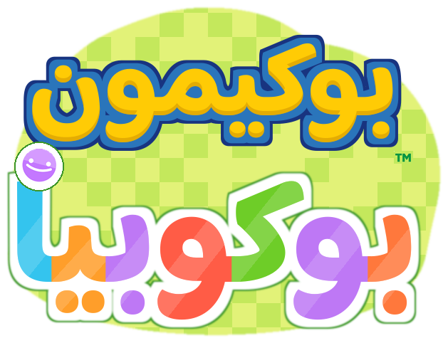
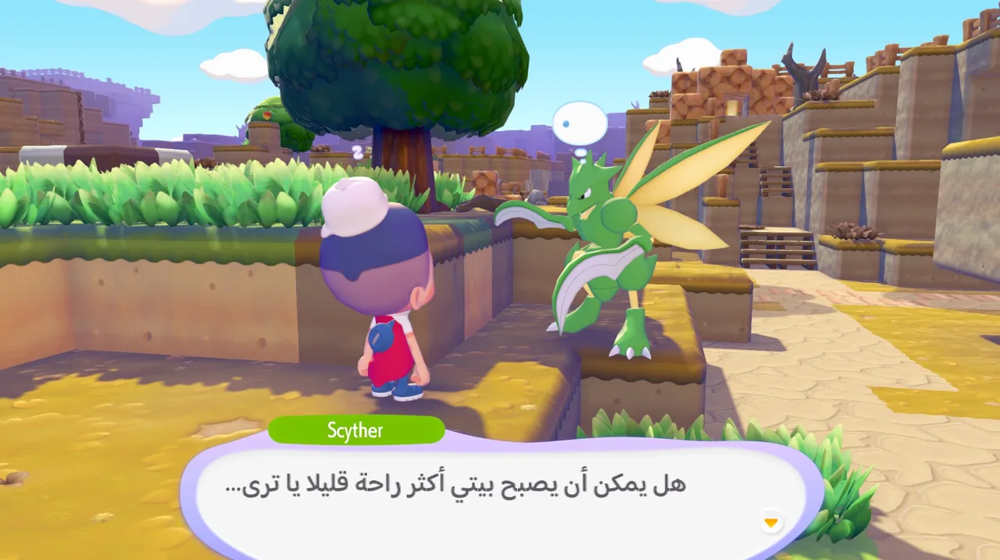
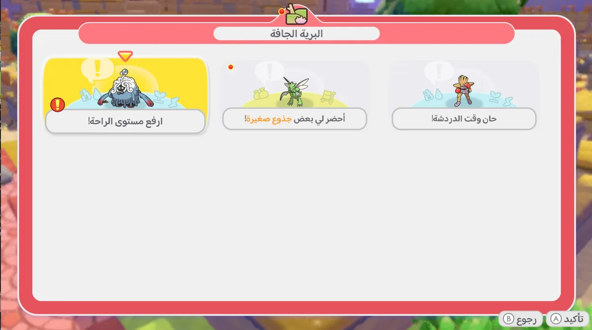
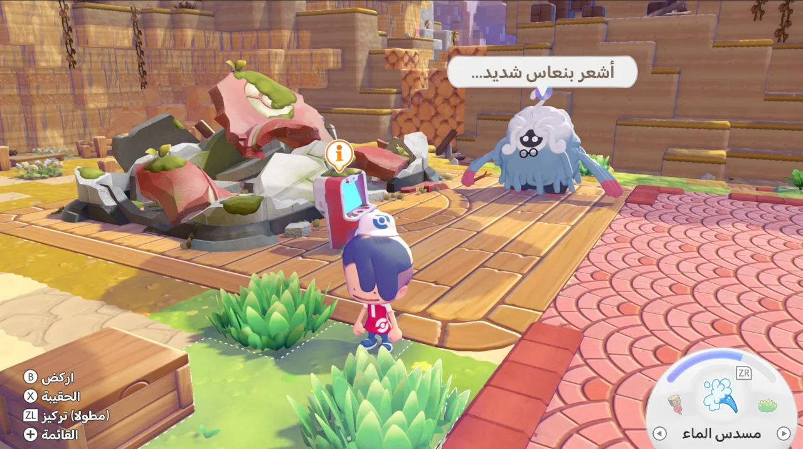
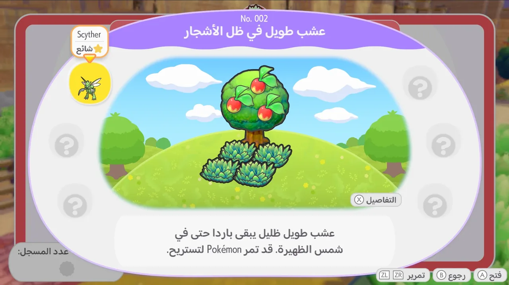

<div dir="rtl">

# تعريب Pokémon Pokopia

<p align="center">
  
</p>

تعريب كامل للعبة **Pokémon Pokopia** على Nintendo Switch 2، يعمل كمود (LayeredFS) على المحاكي.

🌐 **صفحة المشروع:** https://esa14529-alt.github.io/Pokopia-Arabic/

## ⚠️ قبل أن تبدأ

هذا المشروع **اجتهاد شخصي** من أحد محبي اللعبة، وليس ترجمة رسمية.
بذلت جهدي ليكون التعريب مفهوماً وممتعاً، لكن **قد تجد فيه أخطاء**، مثل:

- جملة غير دقيقة أو صياغة غير موفقة.
- نص أطول من مكانه فيظهر مقطوعاً.
- مصطلح مكتوب بأكثر من طريقة، أو تذكير وتأنيث في غير موضعه.

مع ذلك، **التعريب صالح للعب من البداية إلى النهاية**. وإذا وجدت خطأً فأرسل لي صورة للشاشة، وسأصلحه في التحديث القادم.

## ✅ ما الذي تم تعريبه

| الجزء | الحالة |
|---|---|
| القوائم والإعدادات | ✅ |
| أسماء الأدوات والأثاث وأوصافها | ✅ |
| المهام والنصائح | ✅ |
| الحوارات والقصة كاملة | ✅ |
| أسماء المهارات (تحطيم الصخور، القطع، ركوب الأمواج…) | ✅ |
| شاشة البداية: الشعار و«اضغط Ⓐ للبدء» | ✅ |

**أبقيتها بحروفها الأصلية:** أسماء الـ Pokémon (مثل Pikachu)، وأسماء الأشخاص والمدن، وأنواع الكرات (Poké Ball).

## 📸 صور من اللعبة بالعربي

<p align="center">
  
  
  
  
</p>

## 📁 محتوى المشروع

| المجلد / الملف | ما فيه |
|---|---|
| `translation/ar.json` | **ملف الترجمة النهائي**، وفيه كل النصوص العربية (أكثر من 36 ألف موضع في اللعبة) |
| `translation/phase1` … `phase3` | الترجمة مقسمة على دفعات: القوائم، ثم الأدوات، ثم الحوارات |
| `translation/glossary.md` | القاموس الموحد للمصطلحات |
| `translation/phase*/RULES.md` | قواعد الترجمة وطريقة التعامل مع رموز اللعبة |
| `tools/` | أدوات بناء المود والتحقق من الترجمة |
| `arfont/` | الخط العربي المضاف للعبة ([Baloo Bhaijaan 2](arfont/OFL.txt)، رخصة مفتوحة) |
| `assets/title_ar.png` | شعار شاشة البداية بالعربي |
| `PP_Lock.bat` | أداة اختيارية تبقي شريط الطاقة ممتلئاً |

## 🎮 طريقة التثبيت

**المشروع لا يحتوي على أي ملف من ملفات اللعبة.** تحتاج نسختك الخاصة من اللعبة، وأدوات المشروع تقرأ منها الملفات اللازمة وتبني المود على جهازك.

**المتطلبات:**
- Python 3.11 أو أحدث.
- المكتبات: `numpy` و`Pillow` و`fonttools` و`freetype-py` و`uharfbuzz` و`arabic-reshaper` و`python-bidi` و`texture2ddecoder` و`etcpak`.

**الخطوات:**

1. ثبّت المكتبات:
   ```powershell
   py -m pip install numpy Pillow fonttools freetype-py uharfbuzz arabic-reshaper python-bidi texture2ddecoder etcpak
   ```
2. انسخ ملفات اللعبة اللازمة من نسختك. هذه الخطوة تقرأ اللعبة فقط ولا تعدّل عليها:
   ```powershell
   cd tools
   py setup_originals.py "D:\path\to\Pokopia.nup"
   ```
3. حدّد مجلد المود داخل المحاكي:
   ```powershell
   $env:POKOPIA_MOD_DIR = "<مجلد المحاكي>\user\load\0400A3A01EE4C000\Arabic\romfs"
   ```
4. ابنِ المود:
   ```powershell
   py build_mod.py
   ```
5. في المحاكي افتح خصائص اللعبة، ثم الإضافات (Add-ons / Mods)، وفعّل مود **Arabic**.

> **ملاحظة:** أغلق اللعبة قبل البناء، لأن ملفاتها تكون مقفلة وهي تعمل.

## 🛠️ أدوات إضافية (اختيارية)

- **`PP_Lock.bat`:** يبقي شريط الطاقة (PP) ممتلئاً. شغّله بعد أن تدخل على حفظك، وانتظر حتى يكتب «PP found»، واترك نافذته مفتوحة أثناء اللعب. يعمل على ذاكرة المحاكي فقط ولا يغيّر ملفات اللعبة.
- **`tools/trainer.py`:** باحث بسيط في الذاكرة لتعديل القيم، مثل عدد القطع المعدنية.

## ✍️ المساهمة وتصحيح الأخطاء

إذا وجدت خطأً في الترجمة:
1. صوّر الشاشة، واذكر أين ظهر الخطأ في اللعبة إن أمكن.
2. أرسلها لي، أو افتح Issue في هذا المستودع.

إذا أردت أن تعدّل بنفسك: الترجمات في ملفات `translation/phase*/batch_NN.ar.json`. بعد التعديل شغّل `tools/validate_batch.py` للتحقق، ثم `tools/merge_translations.py`، ثم أعد بناء المود.

## ⚖️ إخلاء مسؤولية

هذا مشروع معجبين **غير رسمي وغير ربحي**، ولا علاقة له بـ Nintendo أو The Pokémon Company أو Game Freak أو Koei Tecmo.
Pokémon و Pokopia علامات تجارية لأصحابها. لاستخدام هذا التعريب يجب أن تملك نسخة أصلية من اللعبة.

</div>
